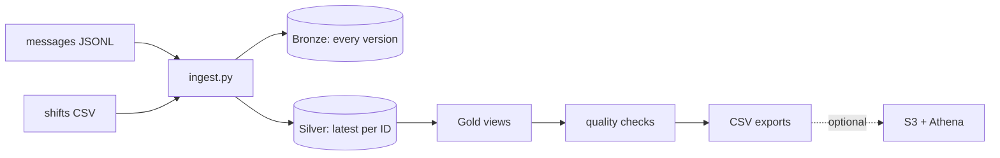

# Design notes

All data in this project is synthetic.

## Flow

## Grain of each table

| Table | One row per |
|---|---|
| `bronze_messages` | message version received (one line of one file) |
| `bronze_shifts` | shift version received (one CSV row) |
| `silver_messages` | message_id (latest version) |
| `silver_shifts` | shift_id (latest version) |
| `gold_fact_message` | message |
| `gold_fact_shift` | shift |
| `gold_daily_facility` | date + facility + channel |
| `gold_dim_facility`, `gold_dim_channel`, `gold_dim_date` | distinct value seen in Silver |

The dimensions are simple lists of distinct values. They're not slowly changing dimensions.

## How loading works

1. Hash the file's bytes with SHA-256. If `ingestion_manifest` already has that hash for this domain, skip the file.
2. Read and validate every row. Any bad row raises an error before anything is written.
3. In one transaction: add the manifest row, insert every row into Bronze, and upsert every row into Silver.
4. The Silver upsert only replaces a row when the incoming `updated_at` is newer. If the timestamps are equal, the higher record hash wins, so the result is the same on every rerun.
5. If anything fails, roll back the whole file.

Gold is views on Silver, so there's nothing to keep in sync.

## Quality checks

`quality.py` runs SQL checks that must return 0. The main ones:

- no duplicate IDs in Silver
- no shifts that end before they start
- no negative response times
- every fact row has a matching dimension row
- the daily summary adds back up to the message fact
- delivered can't be more than sent, and responded can't be more than delivered

`export` runs the checks first and stops if any fail.

## What I'd change for a real system

- Use a real warehouse (Redshift, Snowflake or similar) instead of SQLite
- Use a source sequence number or CDC log position instead of `updated_at` to decide which version is newer
- Send rejected rows somewhere to look at later, instead of failing the whole file
- Add scheduling, retries, logging and alerts
- Store exports as Parquet, partitioned by date, instead of CSV
